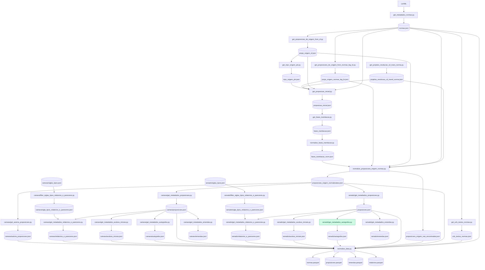

# Coletor de normas e proposições

## Tramitação

`https://www6ghml.senado.gov.br/dadosmateria/resources/materia-bicameral/siglas-tipos-materia-bicameral`
[
  "PDL",
  "PEC",
  "PL",
  "PLP",
  "ECD",
  "PDS",
  "PDC",
  "PLC",
  "PLS",
  "SCD",
  "VET"
]



## Instalar dependências

```
uv sync
```

## Coleta de normas


### Coleta dos metadados de normas a partir do LeXML

* Fonte: [LeXML](https://www.lexml.gov.br/)
* Script: 
    ```
    python -m src.tasks.data_extracion.normas.get_metadados_normas
    ```
* **Campos coletados:**
  * tipo_norma
  * titulo
  * urn
  * relacionamentos
* JSON de saída: [normas.json](https://github.com/joaorobson/data-collector-congresso/blob/main/data/normas/metadados/normas.json)

### Coleta do nome das proposições de origem da norma no portal normas.leg.br

* Fonte: [normas.leg.br](https://normas.leg.br/)
* Campos coletados:
  * urn
  * status
  * sourceProcess
    * @type
    * name
    * @id
* Script:
    ```
    python -m src.tasks.data_extraction.normas.get_proposicoes_de_origem_from_normas_leg_br
    ```
* JSON de saída: [props_origem_normas_leg_br.json](https://github.com/joaorobson/data-collector-congresso/blob/main/data/normas/metadados/props_origem_normas_leg_br.json)

### Coleta das proposições com origem ausnte no portal normas.leg.br

* Script:
    ```
    python -m src.tasks.data_extraction.normas.get_proposicoes_com_origem_faltante
    ```
* JSON de saída: [normas_sem_proposicao_origem.json](https://github.com/joaorobson/data-collector-congresso/blob/main/data/normas/metadados/normas_sem_proposicao_origem.json)


### Coleta do nome das proposições com origem ausente dos Dados Abertos do SF

* Fonte: [Dados Abertos do SF](https://legis.senado.leg.br/dadosabertos/api-docs/swagger-ui/index.html)
* Dados de entrada:
  * [normas_sem_proposicao_origem.json](https://github.com/joaorobson/data-collector-congresso/blob/main/data/normas/metadados/normas_sem_proposicao_origem.json)
* Campos coletados:
  * identificacao (nome da proposição)

* Script:
    ```
    python -m src.tasks.data_extraction.normas.get_proposicao_de_origem_from_sf
    ```
* JSON de saída: [props_origem_sf.json](https://github.com/joaorobson/data-collector-congresso/blob/main/data/normas/metadados/props_origem_sf.json)


### Coleta do nome das proposições das Resoluções da CD

* Fonte: [Dados Abertos da CD](https://dadosabertos.camara.leg.br/swagger/api.html)
* Campos coletados:
  * id
  * nomeProposicao
  * situacao
  * nome_norma
* Scripts:
  *  Coleta de URLs dos Projetos de Resolução da CD:
      ```
      python -m src.tasks.data_extraction.normas.get_urls_projetos_resolucao_cd
      ```
  * Coleta dos dados dos Projetos de Resolução da CD:
      ```
      python -m src.tasks.data_extraction.normas.get_infos_projetos_resolucao_cd
      ``` 
  * Coleta dos Projetos de Resolução da CD transformados em norma:
      ```
      python -m src.tasks.data_extraction.normas.get_projetos_resolucao_cd_transf_norma
      ```
* JSONs de saída:
  * [urls_projetos_resolucao_cd.json](https://github.com/joaorobson/data-collector-congresso/blob/main/data/normas/metadados/urls_projetos_resolucao_cd.json)
  * [infos_projetos_resolucao_cd.json](https://github.com/joaorobson/data-collector-congresso/blob/main/data/normas/metadados/infos_projetos_resolucao_cd.json)
  * [projetos_resolucao_cd_transf_norma.json](https://github.com/joaorobson/data-collector-congresso/blob/main/data/normas/metadados/projetos_resolucao_cd_transf_norma.json)

### Normalização dos metadados das proposições

* Campos gerados:
  * origem_lexml
  * origem_lexml_norm
  * origem_normas.leg.br
  * origem_normas.leg.br_norm
  * origem_sf
  * origem_sf_norm
  * origem_final
  * casas

* Script:
    ```
    python -m src.tasks.data_extraction.normas.normalize_proposicoes_origem_normas
    ```
* JSON de saída: [proposicoes_origem_normalizadas.json](https://github.com/joaorobson/data-collector-congresso/blob/main/data/normas/metadados/proposicoes_origem_normalizadas.json)

### Proposições

#### Câmara dos Deputados

##### Coletar informações gerais das proposições a partir das normas

* Campos coletados:
  * id
  * uri
  * siglaTipo
  * codTipo
  * numero
  * ano
  * ementa
  * dataApresentacao
* Script:
    ```
    python -m src.tasks.data_extraction.camara.proposicoes_from_normas.get_metadados_proposicoes_from_normas
    ```
* JSON de saída: [proposicoes.json](https://github.com/joaorobson/data-collector-congresso/blob/main/data/camara/metadados/proposicoes.json)


##### Coletar emendas das proposições


* Campos coletados:
  * id
  * uri
  * siglaTipo
  * codTipo
  * numero
  * ano
  * ementa
  * dataApresentacao
* Script:
    ```
    python -m src.tasks.data_extraction.camara.proposicoes_from_normas.get_metadados_emendas
    ```
* JSON de saída: [emendas.json](https://github.com/joaorobson/data-collector-congresso/blob/main/data/camara/metadados/emendas.json)

##### Coletar pareceres e relatórios


#### Senado Federal

##### Coletar informações gerais das proposições a partir das normas

* Campos coletados:
  * autoria
  * casaIdentificadora
  * codigoMateria
  * dataApresentacao
  * dataDeliberacao
  * dataSituacaoAtual
  * ementa
  * enteIdentificador
  * id
  * identificacao
  * normaGerada
  * siglaTipoDeliberacao
  * situacaoAtual
  * tipoConteudo
  * tipoDocumento
  * tramitando
* Script:
    ```
    python -m src.tasks.data_extraction.senado.proposicoes_from_normas.get_metadados_proposicoes_from_normas.py
    ```
* JSON de saída: [proposicoes.json](https://github.com/joaorobson/data-collector-congresso/blob/main/data/senado/metadados/proposicoes.json)


##### Coletar emendas das proposições


* Campos coletados:
    * autoria
    * casa
    * codigoColegiado
    * dataApresentacao
    * decisoes
    * descricaoDocumentoEmenda
    * id
    * idCiEmenda
    * idCiEmendado
    * idDocumentoEmenda
    * idProcesso
    * identificacao
    * nomeColegiado
    * numero
    * siglaColegiado
    * subemendas
    * tipo
    * turnoApresentacao
    * urlDocumentoEmenda
* Script:
    ```
    python -m src.tasks.data_extraction.senado.proposicoes_from_normas.get_metadados_emendas
    ```
* JSON de saída: [emendas.json](https://github.com/joaorobson/data-collector-congresso/blob/main/data/senado/metadados/emendas.json)

##### Coletar pareceres e relatórios

